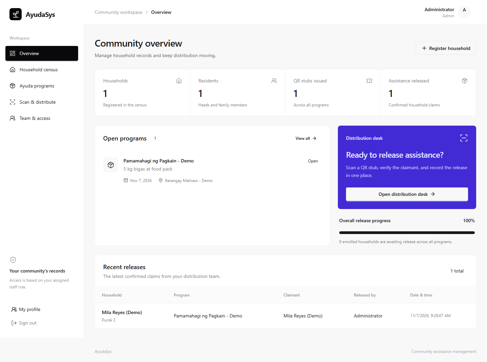
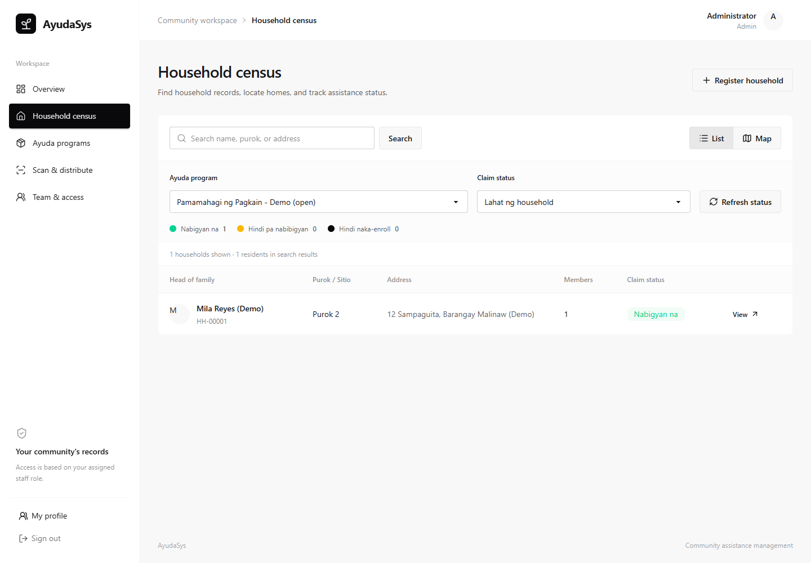
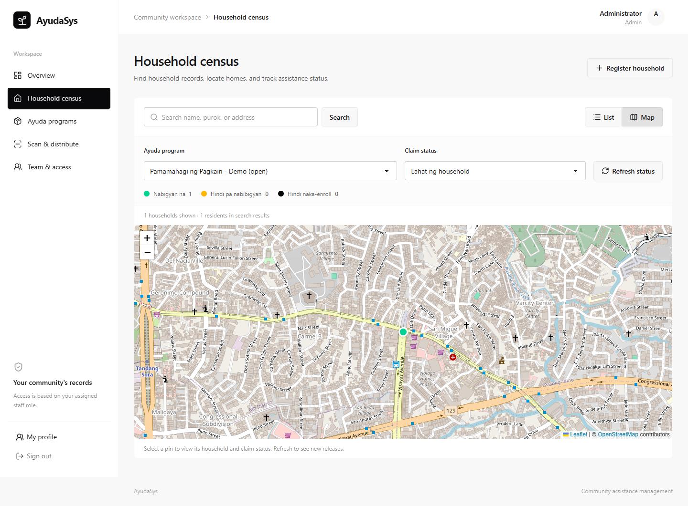
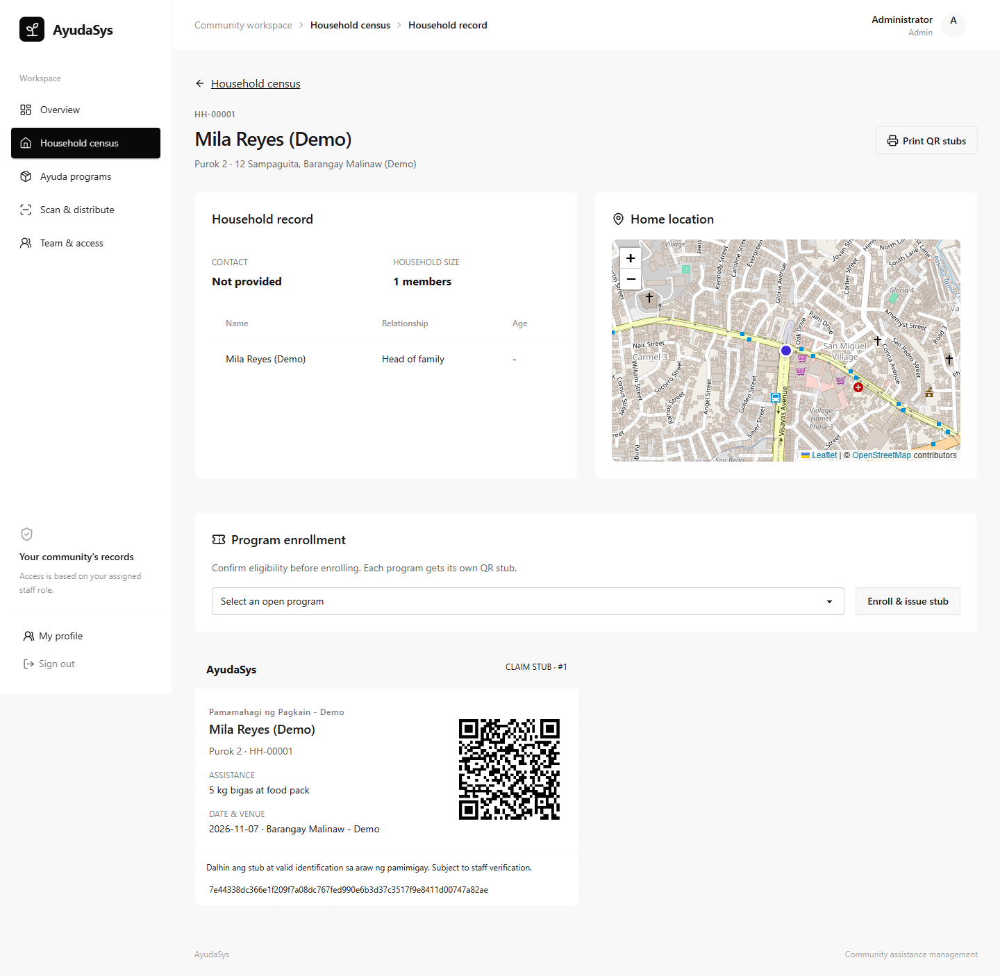
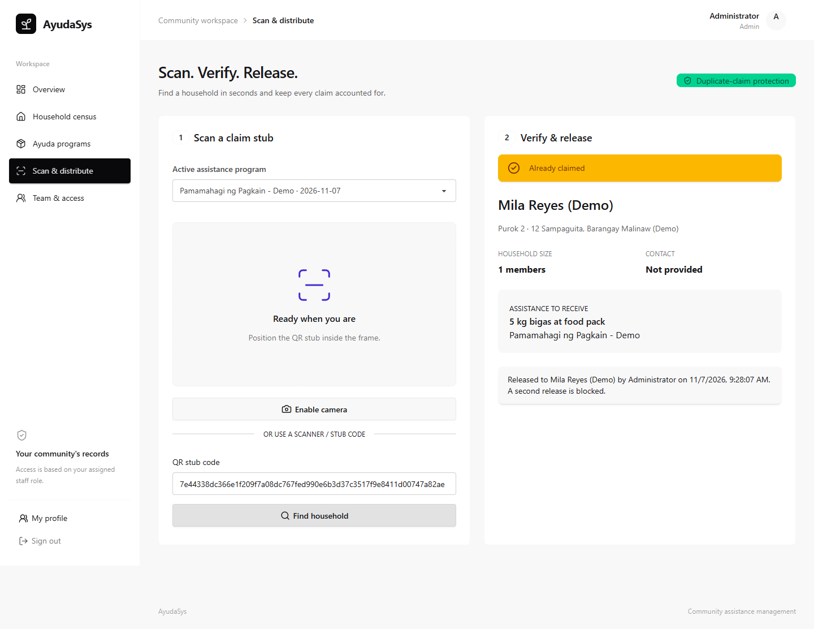
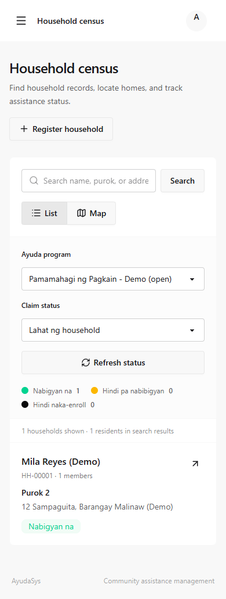

# AyudaSys

**Household census and QR-based assistance distribution for barangay teams.**

Register families, locate their homes, issue program-specific QR stubs, and record verified assistance releases in one staff workspace. AyudaSys connects the census and distribution desk so each release has a household, claimant, releasing officer, and timestamp.

Built with **Go · Fiber · GORM · Vue · Inertia · Tailwind CSS · DaisyUI**.



[Features](#features) · [Screenshots](#screenshots) · [Getting started](#getting-started) · [Workflow](#workflow) · [Deployment](#deployment) · [Troubleshooting](#troubleshooting)

## Features

- **Household census** — Record the head of family, members, ages, contact details, address, and purok/sitio.
- **Community map** — Pin homes, use device location, or enter coordinates. View household claim status on the map.
- **Assistance programs** — Set the distribution date, venue, and assistance package; close a program when distribution ends.
- **Printable QR stubs** — Enroll a household in a program and print its generated stub, or save it as a PDF.
- **Scan, verify, release** — Find an enrollment using a camera, keyboard scanner, or pasted stub code. Staff verify the claimant before confirming release.
- **Duplicate-release protection** — One enrollment per household/program pair and one release per enrollment, enforced by database constraints.
- **Staff access** — Administrator, enumerator, and distributor roles with server-enforced permissions.
- **Overview and release history** — See census totals, issued stubs, confirmed releases, and the eight most recent releases.
- **Responsive workspace** — Desktop tables, mobile household cards, searchable records, claim-status filters, and a mobile navigation drawer.

## Screenshots

These screenshots show the actual application with **fictional demo data**. The sample household and program are not included in a fresh installation. Map attribution is retained.

### Household census and community map

| Searchable household records                                                                             | Homes and claim status                                                                                         |
| -------------------------------------------------------------------------------------------------------- | -------------------------------------------------------------------------------------------------------------- |
|  |  |

### Household record and printable QR stub



### Distribution desk

Staff look up the stub, verify the claimant, and explicitly confirm release. A previously released enrollment displays **Already claimed**.



<details>
<summary><strong>Mobile household census</strong></summary>

<br>


</details>

## Getting started

### Requirements

| Requirement | Version / notes                                             |
| ----------- | ----------------------------------------------------------- |
| Go          | **1.27.1 or newer**, matching `go.mod`                      |
| Node.js     | **24 or newer**, with npm                                   |
| Git         | To clone the repository                                     |
| Database    | SQLite by default; no separate database server is needed    |
| Browser     | A modern browser; camera access requires HTTPS or localhost |

The SQLite driver is written in Go and does not require CGO. MySQL and PostgreSQL drivers are also available through the database configuration.

### 1. Clone the repository

```sh
git clone https://github.com/mendylivium/ayudasys.git
cd ayudasys
```

Run all setup and server commands from this directory, where `go.mod` and `.env.example` are located.

### 2. Create the environment file

**Windows PowerShell**

```powershell
Copy-Item .env.example .env
```

**macOS / Linux**

```sh
cp .env.example .env
```

The default local configuration uses:

```dotenv
APP_ENV=development
APP_PORT=3000
DB_DRIVER=sqlite
DB_FILE=./storage/database.db
SESSION_DRIVER=database
```

### 3. Install dependencies and generate a secret

```sh
go mod download
npm ci
go run . key:generate
```

The last command **prints** a `JWT_SECRET=...` line. Copy its value into the existing `JWT_SECRET=` entry in `.env`; it does not update the file automatically.

### 4. Create the database and build the frontend

```sh
go run . migrate --seed
npm run build
```

Migrations create the application and session tables. The seeder creates the local staff accounts below. It does not create household records or assistance programs.

### 5. Start the server

```sh
go run . serve
```

Open **[http://localhost:3000](http://localhost:3000)**.

### Local demo accounts

| Role          | Email                     | Password   |
| ------------- | ------------------------- | ---------- |
| Administrator | `admin@example.com`       | `password` |
| Enumerator    | `enumerator@example.com`  | `password` |
| Distributor   | `distributor@example.com` | `password` |

These credentials are for local development. Change passwords in **My profile** before real use. Setting `SEED_PASSWORD` to a value between 12 and 72 characters changes the password used for newly seeded accounts; re-seeding does not overwrite existing accounts.

### Run a compiled binary

**Windows PowerShell**

```powershell
go build -o bin/ayudasys.exe .
.\run.cmd
```

`run.cmd` starts the binary from the project root, including when launched by double-clicking it. Build the frontend and run migrations first using the steps above.

**macOS / Linux**

```sh
go build -o bin/ayudasys .
./bin/ayudasys serve
```

Keep the terminal open while using the application. Press `Ctrl+C` to stop the foreground server.

## Development

For live frontend updates, run these in **two terminals** from the project root:

```sh
# Terminal 1: Go server
go run . serve
```

```sh
# Terminal 2: Vite development server
npm run dev
```

Continue opening the app at **http://localhost:3000**. Vite provides the frontend assets and hot reload; restart the Go process after backend changes.

Useful commands:

| Command                   | Purpose                                       |
| ------------------------- | --------------------------------------------- |
| `go run . migrate:status` | Show which migrations have run                |
| `go run . migrate`        | Apply pending migrations                      |
| `go run . db:seed`        | Create missing seeded staff accounts          |
| `npm run build`           | Build production frontend assets into `dist/` |
| `npm run format`          | Format frontend source files                  |
| `go test ./...`           | Run Go tests                                  |
| `go vet ./...`            | Run Go static checks                          |

## Workflow

1. **Create a program.** An administrator enters the program name, assistance package, date, and venue in **Ayuda programs**.
2. **Register the family.** An administrator or enumerator records household details and marks its home in **Household census**.
3. **Review eligibility and enroll.** Staff determine eligibility, select the appropriate program on the household record, and issue its QR stub.
4. **Print the stub.** Use **Print QR stubs**. The browser print dialog can also save a PDF.
5. **Look up and verify.** At **Scan & distribute**, select the program, scan or enter the stub code, and verify the household and claimant's identification.
6. **Confirm release.** Record the actual claimant's name and confirm. **Scanning alone does not record a release.**
7. **Monitor and close.** Review the dashboard and close completed programs to stop further enrollment and claims.

### Role permissions

| Action                               | Administrator | Enumerator | Distributor |
| ------------------------------------ | :-----------: | :--------: | :---------: |
| View dashboard and programs          |       ✓       |     ✓      |      ✓      |
| View household census and map        |       ✓       |     ✓      |      —      |
| Register households                  |       ✓       |     ✓      |      —      |
| Enroll households and print stubs    |       ✓       |     ✓      |      —      |
| Look up stubs and release assistance |       ✓       |     —      |      ✓      |
| Create and close programs            |       ✓       |     —      |      —      |
| Manage staff access                  |       ✓       |     —      |      —      |
| Update own profile and password      |       ✓       |     ✓      |      ✓      |

Public registration is disabled. Administrators create staff accounts in **Team & access**. Revoking an account preserves its recorded release attribution.

## Data and operational notes

- **QR contents:** The QR contains a random 256-bit enrollment token, not a name or address. The printed stub separately displays household and program details.
- **Authenticated lookup:** A valid staff session and the matching program are required to look up an enrollment.
- **Release integrity:** Database uniqueness constraints prevent duplicate enrollment and release. A transaction checks program status before release is recorded.
- **Eligibility:** Staff make eligibility decisions before enrollment; the app does not automatically decide eligibility from household characteristics.
- **Connectivity:** The app needs a connection to the Go server. There is no offline claim queue.
- **Maps:** OpenStreetMap tiles need internet access. Staff can still enter coordinates manually when tiles are unavailable.
- **Camera and location:** Browser permission and HTTPS are required, except on localhost. A phone visiting a plain HTTP LAN address may not have camera access. A keyboard scanner or pasted stub code is also supported.

## Deployment

Build for the target operating system:

```sh
npm ci
npm run build
go build -o bin/ayudasys .
```

For Windows, use `go build -o bin/ayudasys.exe .` instead.

The runtime needs the compiled binary, `dist/`, `public/`, an environment file, and a writable storage location. Run it with the project directory as its working directory. Frontend assets are embedded in neither the executable nor the repository's ignored build output.

Before starting a production instance:

1. Set `APP_ENV=production`, a strong `JWT_SECRET`, and the production database configuration.
2. Serve through an HTTPS reverse proxy. Secure session cookies are enabled by default in production.
3. Apply migrations from the deployment directory. For a first installation, set a strong `SEED_PASSWORD` before running `migrate --seed`; production seeding rejects a missing password.
4. Replace development account details and assign individual staff accounts.
5. Back up the database using a database-aware backup procedure, and keep SQLite storage persistent across deployments.

This application needs a Go-capable server. **GitHub Pages cannot host the backend.**

## Troubleshooting

| Symptom                                     | What to check                                                                                                                                                                                                            |
| ------------------------------------------- | ------------------------------------------------------------------------------------------------------------------------------------------------------------------------------------------------------------------------ |
| `no such table: sessions`                   | Stop the server, return to the project root, and run `go run . migrate`. Check `DB_FILE` and any environment overrides. Starting inside `bin/` can open a separate `bin/storage/database.db`; on Windows, use `run.cmd`. |
| Missing frontend assets or an unstyled page | Run `npm ci` and `npm run build`. For live development, keep `npm run dev` running. If Vite was interrupted and `storage/vite.hot` remains, remove that stale file before using the production build.                    |
| Port 3000 is already in use                 | Stop the existing server or change `APP_PORT` in `.env`, then restart.                                                                                                                                                   |
| Camera is unavailable on a phone            | Use HTTPS, allow camera permission, and check the device browser. Localhost access on your computer does not make an HTTP LAN address secure on your phone.                                                              |
| Map tiles do not load                       | Check internet access to the tile service, or enter latitude and longitude manually.                                                                                                                                     |
| Seeded login does not work                  | Run `go run . migrate --seed` against the same database as the server. An existing account retains its previous password.                                                                                                |
| Go test cleanup is blocked on Windows       | If antivirus temporarily locks test executables, use `go test -work ./...` to retain the work directory.                                                                                                                 |

## Verification

```sh
go test ./...
go vet ./...
npm run build
```

HTTP tests cover authentication, CSRF protection, role boundaries, census validation, enrollment uniqueness, wrong-program lookup, duplicate claim prevention, release attribution, closed programs, and staff creation. Browser checks have covered the registration-to-release workflow and responsive layouts at 320, 390, 768, and 1440 pixels.

SQLite has been exercised locally. MySQL/PostgreSQL drivers are available but have not been integration-tested for this application. Physical camera scanning and printer output should be checked on the devices intended for distribution.

## Project structure

```text
app/                 Controllers, request validation, models, and CLI commands
bootstrap/           Application initialization
config/              Environment-based configuration
database/            Database connection, migrations, and seeders
resources/js/        Vue pages, components, and layouts
resources/css/       Tailwind/DaisyUI setup and layout styles
routes/              Web and API route definitions
public/              Static assets
tests/               Go feature tests
docs/                Design notes and README screenshots
ads/ayudasys/        Optional Remotion promotional-film project
run.cmd              Windows launcher for the compiled application
```

`.env`, local databases, dependencies, and generated application builds are excluded by `.gitignore`. The [promotional-film project](ads/ayudasys/README.md) is separate from the application and is not needed to run AyudaSys.

## Acknowledgments

AyudaSys is built on [mendylivium/go-mvc](https://github.com/mendylivium/go-mvc). It uses Fiber and GORM for the backend; Vue and Inertia for the interface; Tailwind CSS and the default DaisyUI light theme for styling; Leaflet and OpenStreetMap for maps; and `html5-qrcode` / `qrcode` for scanning and stub generation.
